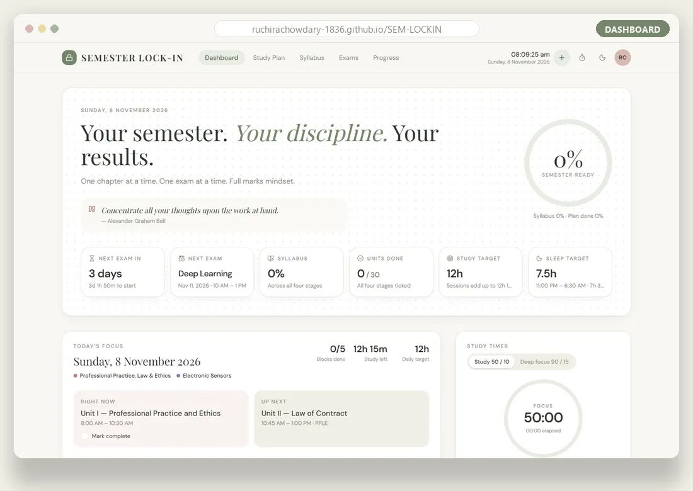
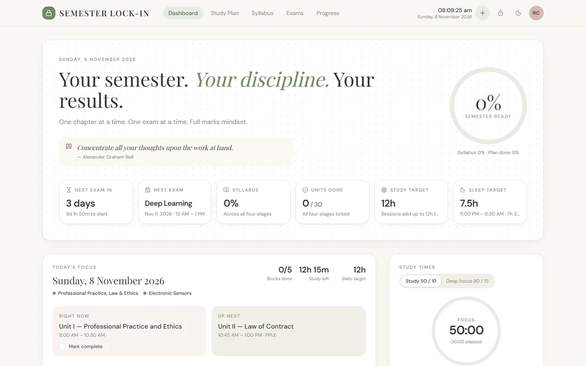
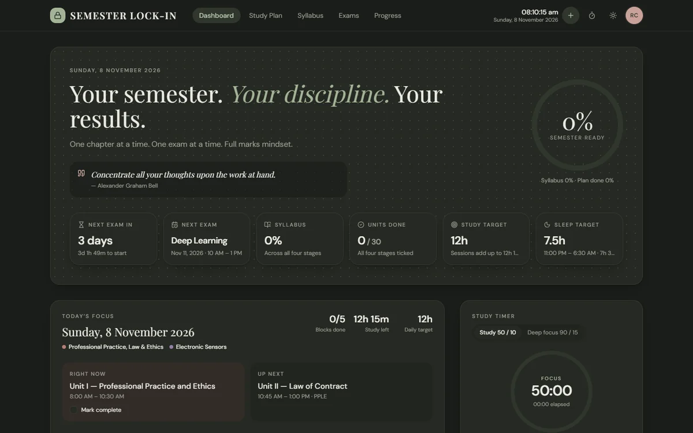
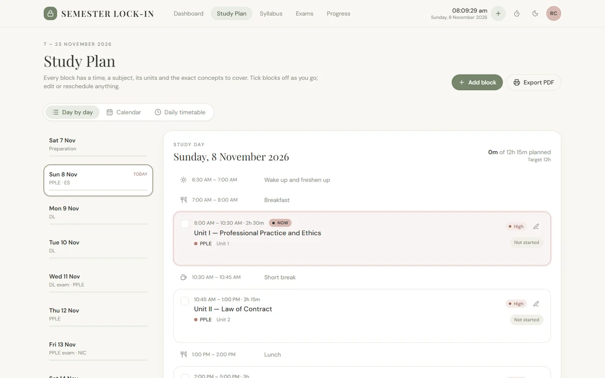
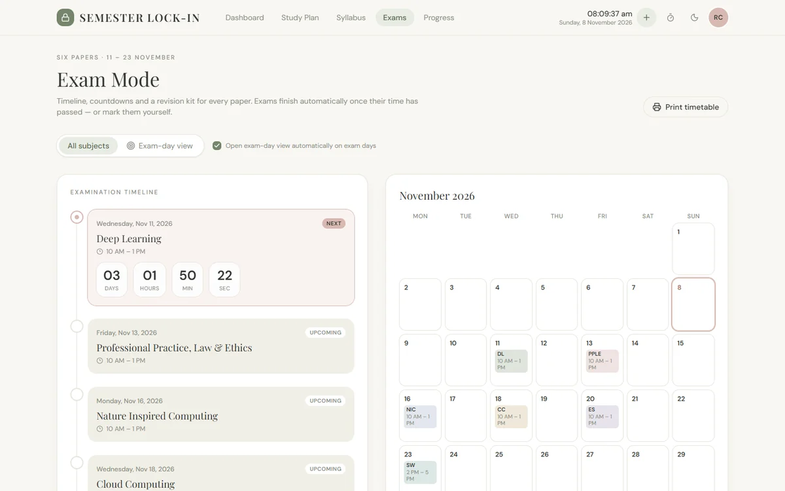
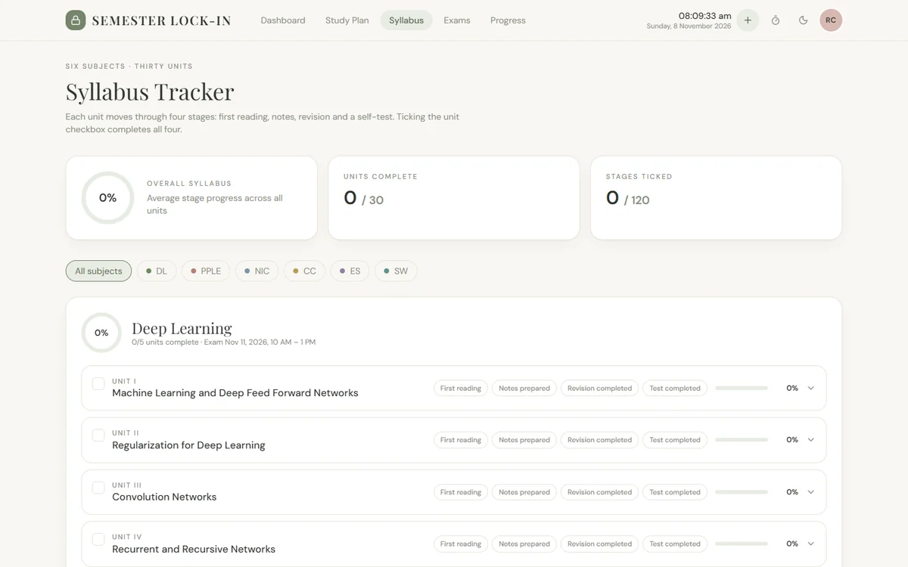
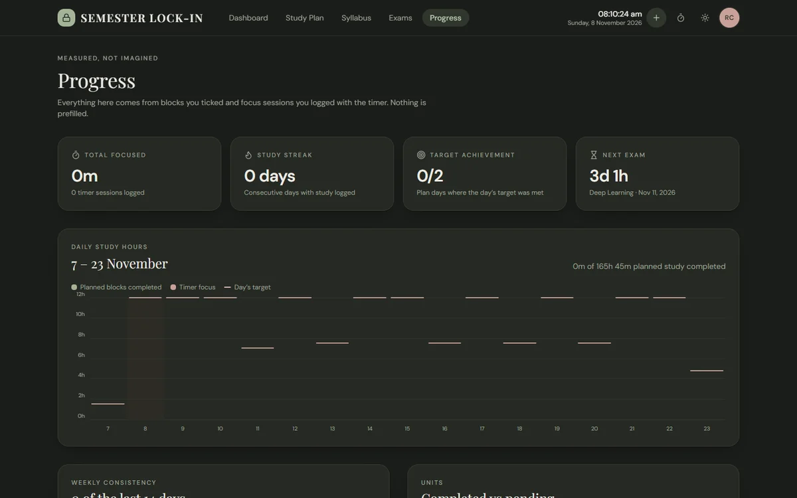

<div align="center">

<a href="https://ruchirachowdary-1836.github.io/SEM-LOCKIN/">
  <picture>
    <source media="(prefers-color-scheme: dark)" srcset=".github/assets/banner-dark.svg">
    
  </picture>
</a>

<br>

<picture>
  <source media="(prefers-color-scheme: dark)" srcset=".github/assets/typing-dark.svg">
  
</picture>

<br><br>

<a href="https://ruchirachowdary-1836.github.io/SEM-LOCKIN/"></a>

<br><br>

<a href="https://github.com/ruchirachowdary-1836/SEM-LOCKIN/actions/workflows/deploy.yml"></a>


</div>

<picture>
  <source media="(prefers-color-scheme: dark)" srcset=".github/assets/divider-dark.svg">
  
</picture>

## 🔒 What it is

**Semester Lock-In** is a calm, focused planner for the semester exam fortnight. It lays out every study day hour by hour, tracks each subject unit through *reading → notes → revision → test*, counts down to every paper, and keeps you honest with a focus timer and progress charts.

Everything runs in your browser. There's **no sign-up, no server and no paid API**. Your progress is saved on your own device.

<p align="center">
  <a href="https://ruchirachowdary-1836.github.io/SEM-LOCKIN/">
    
  </a>
</p>

## ✨ Features

<picture>
  <source media="(prefers-color-scheme: dark)" srcset=".github/assets/features-dark.svg">
  
</picture>

<details open>
<summary><b>Every page at a glance</b></summary>
<br>

| Page | What it does |
|---|---|
| [**Dashboard**](https://ruchirachowdary-1836.github.io/SEM-LOCKIN/) | Hero stats, overall readiness ring, today's focus (live current and next block), timer, exam countdown, priority tasks |
| [**Study Plan**](https://ruchirachowdary-1836.github.io/SEM-LOCKIN/plan/) | Day-by-day plan for 7–23 Nov with concepts, checkboxes, status and priority. Edit, reschedule, add or remove blocks. Calendar view and an editable daily timetable |
| [**Syllabus**](https://ruchirachowdary-1836.github.io/SEM-LOCKIN/syllabus/) | 6 subjects × 5 units, each with four stages (reading, notes, revision, test), plus progress and notes per unit and subject |
| [**Exams**](https://ruchirachowdary-1836.github.io/SEM-LOCKIN/exams/) | Exam timeline and calendar, live countdown, a prep kit per subject (topics, revision checklist, diagrams, 10-mark answers) and an exam-day view |
| [**Progress**](https://ruchirachowdary-1836.github.io/SEM-LOCKIN/progress/) | Daily hours chart, 14-day consistency, units donut, progress by subject, streak, target achievement and session log |
| [**Focus**](https://ruchirachowdary-1836.github.io/SEM-LOCKIN/focus/) | Full-screen focus timer (50/10 and 90/15) linked to the current block |
| [**Journal**](https://ruchirachowdary-1836.github.io/SEM-LOCKIN/journal/) | Daily study journal |
| [**Tasks**](https://ruchirachowdary-1836.github.io/SEM-LOCKIN/tasks/) | Priority task manager. Press <kbd>N</kbd> anywhere for quick add |
| [**Settings**](https://ruchirachowdary-1836.github.io/SEM-LOCKIN/settings/) | Theme, notifications, JSON export and import, automatic daily snapshots, reset with confirmation |
| **Print** | Print and Save-as-PDF views of the [plan](https://ruchirachowdary-1836.github.io/SEM-LOCKIN/print/plan/) and the [exam timetable](https://ruchirachowdary-1836.github.io/SEM-LOCKIN/print/exams/) |

</details>

## 🖼️ Screenshots

<table>
  <tr>
    <td width="50%"><p align="center"><sub><b>Dashboard</b> · light</sub></p></td>
    <td width="50%"><p align="center"><sub><b>Dashboard</b> · dark</sub></p></td>
  </tr>
  <tr>
    <td><p align="center"><sub><b>Study plan</b> · hour-by-hour blocks</sub></p></td>
    <td><p align="center"><sub><b>Exam mode</b> · live countdown</sub></p></td>
  </tr>
  <tr>
    <td><p align="center"><sub><b>Syllabus</b> · four stages per unit</sub></p></td>
    <td><p align="center"><sub><b>Progress</b> · measured, not imagined</sub></p></td>
  </tr>
</table>

<picture>
  <source media="(prefers-color-scheme: dark)" srcset=".github/assets/divider-dark.svg">
  
</picture>

## 🚀 Run it locally

```bash
npm install
npm run dev                  # http://localhost:3400
npm run build                # static export into ./out
```

## 🌐 Deployment: GitHub Pages

The live site is hosted entirely on GitHub and needs no other service.

- `next.config.mjs` uses `output: "export"`, so the whole app builds into plain static files.
- [`.github/workflows/deploy.yml`](.github/workflows/deploy.yml) runs on every push to `main`. It builds with `NEXT_PUBLIC_BASE_PATH=/SEM-LOCKIN` so every route and asset works under the repo's sub-path, then publishes `out/` to Pages.
- To deploy a fork, set **Settings → Pages → Source** to **GitHub Actions** and push to `main`.

## 🗒️ Notes

- All times are **Asia/Kolkata**, whatever the device's time zone.
- Exam hours never count as study. On exam days the target is the blocks scheduled after the paper.
- The default timetable's study sessions add up to **12 h 15 m** (2.5 + 2.25 + 3 + 2.5 + 2). The daily target stays at 12 h and both numbers are shown.
- Data lives in `localStorage` under `sli:state:v1`, with snapshots in `sli:snapshots:v1`. Use **Settings → Export** to back up or move your progress between devices.

<br>

<div align="center">
  
  <br>
  <sub><i>One chapter at a time. One exam at a time.</i></sub>
  <br><br>
  <a href="https://ruchirachowdary-1836.github.io/SEM-LOCKIN/"><b>ruchirachowdary-1836.github.io/SEM-LOCKIN</b></a>
</div>
